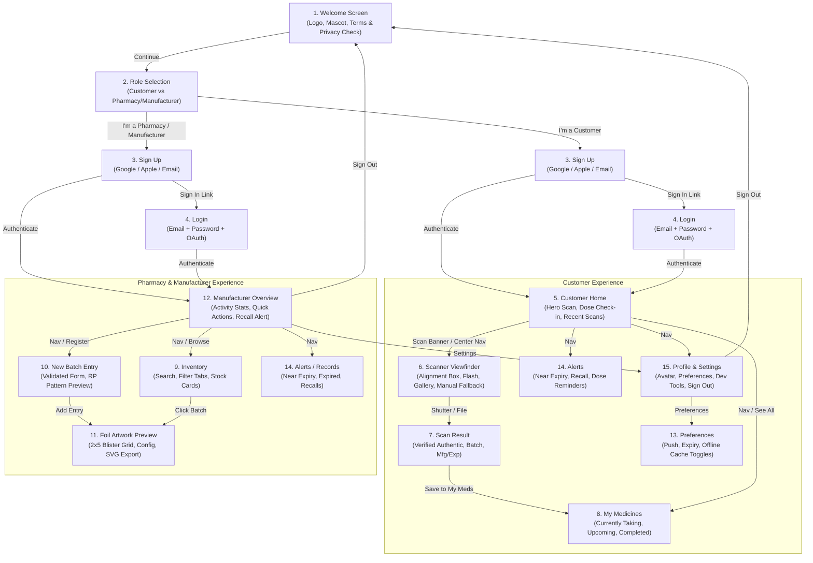

# Striply — Application Navigation & Screen Flow (FLOW.md)

> **Complete Screen Hierarchy & User Flow**

---

---

## Screen Transition Matrix

| # | Screen Name | Route / Key | Primary Actions & Handlers | Back Destination |
|---|---|---|---|---|
| 1 | Welcome | `'welcome'` | Check T&C, Check Privacy, `Continue -> Role` | None (Root) |
| 2 | Role Selection | `'role'` | Select Customer, Select Pharmacy -> `Signup` | `Welcome` |
| 3 | Sign Up | `'signup'` | Continue with Google, Continue with Apple, Email -> `Login` | `Role` |
| 4 | Log In | `'login'` | Email/Password entry, show/hide password, Forgot password, Google/Apple OAuth -> Finish to Role Home | `Signup` / `Role` |
| 5 | Customer Home | `'home'` | Scan medicine hero, Dose check-in, Recent scans, Customer Nav | Exit |
| 6 | Scanner HUD | `'scan'` | Viewfinder, Flash toggle, Gallery file upload, Shutter capture, Manual batch code modal -> `Result` | `Home` |
| 7 | Scan Result | `'result'` | Save to My Medicines -> `Medicines`, Scan Another -> `Scan` | `Scan` |
| 8 | My Medicines | `'medicines'` | Tabs (Currently Taking, Upcoming, Completed), View detail | `Home` |
| 9 | Inventory | `'inventory'` | Real-time search, Filter tabs, Select batch -> `Foil` | `Org` |
| 10 | New Batch Entry | `'batch'` | Form validation, Date pickers, RP Lines pattern preview, Add entry -> `Foil` | `Inventory` |
| 11 | Foil Artwork Preview | `'foil'` | Blister 2x5 grid, Foil width & repeat controls, Zoom (Fit/100%/200%), Export SVG artwork -> Download file | `NewBatch` / `Inventory` |
| 12 | Organization Overview | `'org'` | Metric cards, Quick action tiles, Recall alert, Pharma Nav | Exit |
| 13 | Preferences | `'prefs'` | Notification toggles, Expiry alerts toggle, Offline cache toggle | `Profile` |
| 14 | Alerts | `'alerts'` | Tabs (All, At Risk, Notes), Alert cards | Prior tab |
| 15 | Profile | `'profile'` | Account stats, Preferences link, Dev tools drawer launcher, Sign out | Prior tab |
