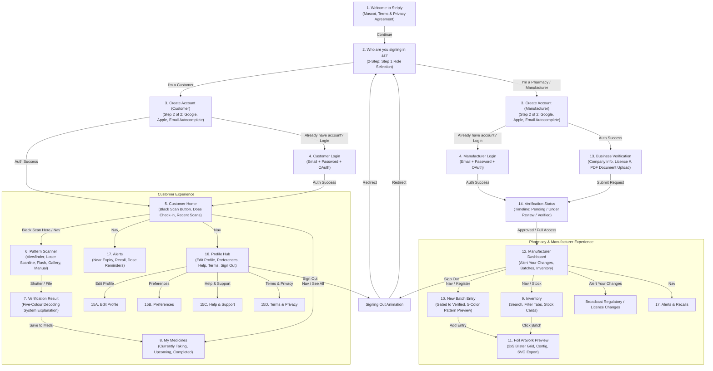

# Striply — Application Navigation & Screen Flow (FLOW.md)

> **Updated Screen Flow & Architecture (5-Colour System & Business Verification)**

---

---

## Screen Directory & Handlers

| Key | Screen Title | Navigation & Trigger | Destination / Actions |
|---|---|---|---|
| `'welcome'` | Welcome to Striply | Initial app open | Check T&C & Privacy -> `'role'` |
| `'role'` | Who are you signing in as? | Continue from Welcome / Post Sign-out | Customer or Manufacturer -> `'signup'` |
| `'signup'` | Create your account | Step 2 of 2 indicator | Google/Apple Modal, Email autocomplete, Submit -> Customer Home or Business Verification |
| `'login'` | Log in to Striply | From Signup link | OAuth or Email/Password -> Customer Home or Status |
| `'home'` | Customer Home | Primary hub | Black scan button -> `'scan'`, Dose toggle, Recent scans |
| `'scan'` | Scan Verification Pattern | Dark optical HUD | Flash toggle, Gallery file upload, Shutter capture, Manual fallback -> `'result'` |
| `'result'` | Verification Result | Decoded result | 5-colour encoding cards (Red, Blue, Green, Yellow, Purple), Save to cabinet |
| `'medicines'` | My Medicines | Nav item | Tabs: Currently Taking, Upcoming, Completed |
| `'inventory'` | Inventory | Pharma Nav | Real-time search, category filters, batch cards -> `'foil'` |
| `'batch'` | New Batch Entry | Pharma Nav | Validated inputs, 5-color live pattern generator -> `'foil'` |
| `'foil'` | Foil Artwork Preview | From Batch/Inventory | 2x5 blister layout, repeat configuration, Export SVG download |
| `'org'` | Manufacturer Overview | Pharma Home | Metric tiles, "Alert Your Changes" broadcasting modal, Quick actions |
| `'business-verify'` | Business Verification | Manufacturer Onboarding | Company details, Drug licence #, PDF licence file upload |
| `'verify-status'` | Verification Status | Post-verification | Timeline (Pending, Under Review, Verified), Evaluator demo toggle |
| `'edit-profile'` | Edit Profile | Profile link | Full Name, Email, Phone, Avatar change & save |
| `'prefs'` | Preferences | Profile link | Push, Expiry alerts, Offline cache, Audio chimes |
| `'help-support'` | Help & Support | Profile link | FAQs, Support Email, 24/7 Helpline |
| `'terms-privacy'` | Terms & Privacy | Profile link | Terms of Service, Medical & Traceability Disclaimer |
| `'alerts'` | Alerts | Nav item | All, At Risk, Notes tabs |
| `'profile'` | My Profile Hub | Nav item | User info, Links to 4 sub-screens, Sign out -> `'role'` |
