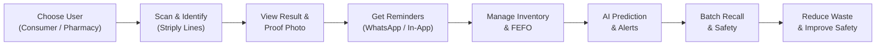
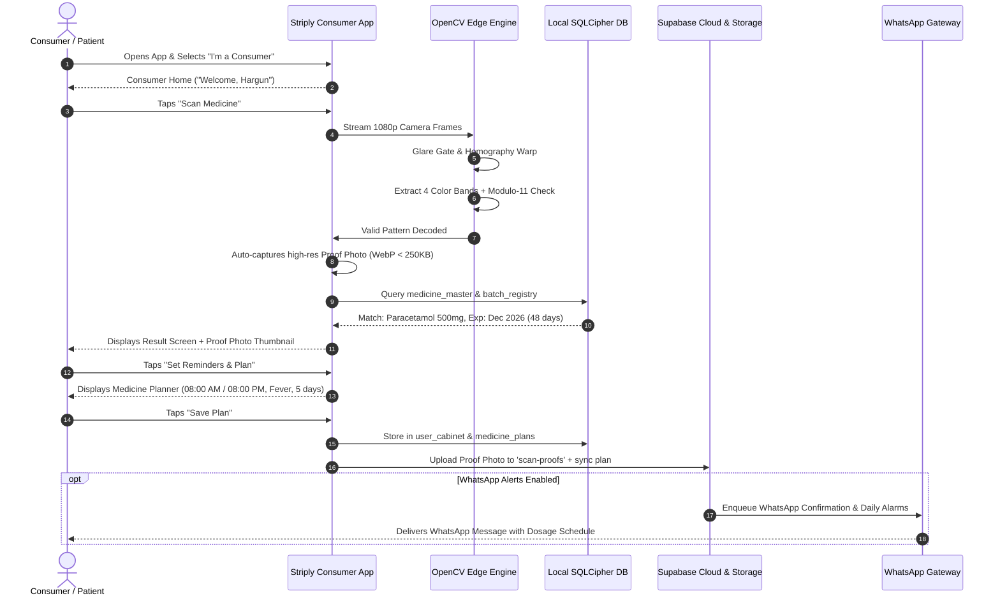
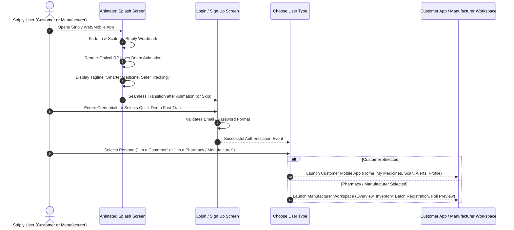
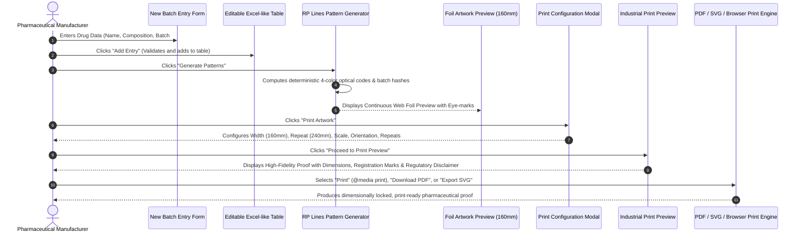

# Striply — System Execution Flows (FLOW.md)

> **Purpose:** Detailed end-to-end trace of execution paths across client components, edge computer vision algorithms, FEFO dispatch engine, Supabase triggers, and WhatsApp notification gateways.

---

## 1. Overall App Architecture Flow



---

## 2. Consumer Execution Flow: Scan, Proof, Plan & Remind



---

## 3. Pharmacy Execution Flow: Dashboard, FEFO, AI Expiry & Recalls

```mermaid
sequenceDiagram
    autonumber
    actor Chemist as Retail / Hospital Pharmacist
    participant Portal as Next.js Web Portal / Mobile App
    participant Supa as Supabase PostgreSQL Engine
    participant FEFO as FEFO Dispatch Engine
    participant AI as Python AI Microservice (LightGBM + PuLP)

    Chemist->>Portal: Logs in with Pharmacy Credentials
    Portal->>Supa: Fetch Org Metrics
    Supa-->>Portal: Total Stock (1,248), Near Expiry (36), Expired (8), High Risk (24)
    
    rect rgb(15, 30, 70)
        Note over Portal,FEFO: FEFO (First Expiry, First Out) Stock Prioritization
        Chemist->>Portal: Dispenses Prescription for Amoxicillin 250mg
        Portal->>FEFO: get_fefo_batch_for_dispensing(org_id, med_code, qty)
        FEFO-->>Portal: Recommends Batch BTH-2041 (Exp: 22 Nov 2026) FIRST
        Chemist->>Portal: Confirms Dispensing (Stock decremented)
    end

    rect rgb(20, 40, 90)
        Note over Portal,AI: AI Expiry Intelligence & Smart Redistribution
        Supa->>AI: Webhook Trigger: Send batches with days_to_expiry <= 90
        AI->>AI: Predict 60-day consumption velocity (V_hat)
        AI->>AI: Identify High Risk (24 batches likely to expire unsold)
        AI->>AI: PuLP Solver matches surplus to nearby clinic shortage
        AI->>Supa: INSERT into redistribution_requests
        Supa-->>Portal: Alert: "Reallocate 80 units of Paracetamol to nearby branch"
        Chemist->>Portal: Clicks "Approve Transfer" -> Manifest Generated
    end

    rect rgb(70, 20, 20)
        Note over Portal,Supa: Batch Recall Emergency Workflow
        Supa->>Supa: Manufacturer issues recall on Ciprofloxacin (CIP-2025)
        Supa-->>Portal: Critical Alert Card: "⚠️ Batch Recall CIP-2025: Isolate & Return"
        Chemist->>Portal: Clicks "Mark as Quarantined" -> Stock isolated from FEFO
    end
```



---

## 4. WhatsApp Notification Event Loop

```
[System Event Occurs]
  ├── A. Consumer sets new medicine plan -> 'PLAN_CONFIRMATION'
  ├── B. Daily reminder alarm fires (08:00 AM) -> 'MED_REMINDER'
  ├── C. Batch reaches <= 30 days to expiry -> 'EXPIRY_ALERT'
  └── D. Manufacturer issues batch recall -> 'RECALL_ALERT'
          |
          v
[INSERT into public.whatsapp_queue (status = 'PENDING')]
          |
          v
[Supabase Database Webhook fires to Notification Gateway]
          |
          v
[Twilio / Gupshup API delivers template message to recipient WhatsApp]
          |
          v
[UPDATE public.whatsapp_queue SET status = 'SENT', sent_at = NOW()]
```


---

## 4. Complete Application Opening & Authentication Flow



---

## 5. Industrial Blister-Foil Printing & Proof Engine Flow


